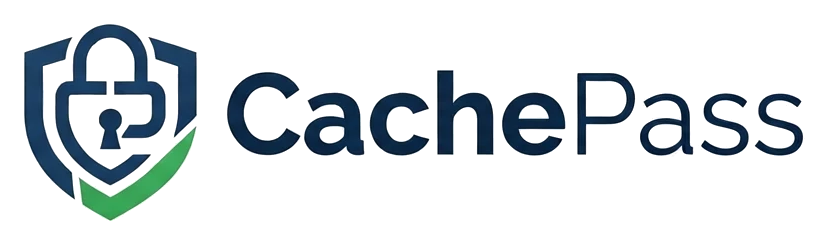

<p align="center">
  <picture>
    <source media="(prefers-color-scheme: dark)" srcset=".github/assets/cachepass-logo-dark.png">
    
  </picture>
</p>

<p align="center">
  <strong>The open-source, self-hosted password manager that never sees your passwords.</strong><br>
  End-to-end encrypted in the browser · zero-knowledge server · your infrastructure, your keys.
</p>

<p align="center">
  <a href="LICENSE"></a>
  <a href="docs/ROADMAP.md#security-audit-milestones"></a>
  
</p>

<p align="center">
  <a href="#overview">Overview</a> ·
  <a href="#repositories">Repositories</a> ·
  <a href="#how-it-works">How it works</a> ·
  <a href="#getting-started">Getting started</a> ·
  <a href="#documentation">Documentation</a> ·
  <a href="#security">Security</a> ·
  <a href="#contributing">Contributing</a>
</p>

---

## Overview

CachePass is a password manager for developers, individuals and teams who want
full control over their credentials. Vault data is encrypted and decrypted
**inside the browser** by a Rust engine compiled to WebAssembly. The server —
which you run — stores ciphertext only and never receives your master password,
your vault key or any plaintext.

| | |
|---|---|
| **Zero-knowledge by design** | Argon2id → HKDF-SHA-256 → XChaCha20-Poly1305, with ciphertexts bound to their vault and item. Item names, types and folders are encrypted too. |
| **Self-hosted** | One Docker Compose stack: Caddy (automatic TLS), the static web app, a Rust API and PostgreSQL on an internal network. |
| **Two separate secrets** | An *account password* to sign in (resettable by email) and a *master password* to decrypt (never leaves the device, never recoverable). |
| **Built to be reviewed** | Open specification with test vectors, an explicit threat model and documented limitations. |

> [!IMPORTANT]
> CachePass is **pre-1.0 and has not been independently audited**. Do not rely on
> it for secrets you cannot afford to lose or expose until the external review in
> the [roadmap](docs/ROADMAP.md#security-audit-milestones) is complete.

## Repositories

CachePass is four independent repositories with no shared code. Contracts between
them are documents: the API contract is the backend's generated `openapi.json`, the
cryptographic contract is [CRYPTOGRAPHY.md](docs/CRYPTOGRAPHY.md).

| Repository | Purpose | Stack |
|---|---|---|
| [**cachepass-webapp**](https://github.com/CachePass/cachepass-webapp) | The password manager client and the vault crypto engine (`crypto/`, Rust → WASM) | SvelteKit 3 SPA, Svelte 5, TypeScript, Zod, Rust |
| [**cachepass-backend**](https://github.com/CachePass/cachepass-backend) | REST API, PostgreSQL schema, authentication and sessions, deployment | Rust, Axum, Tokio, SQLx, PostgreSQL, Utoipa |
| [**cachepass-website**](https://github.com/CachePass/cachepass-website) | Public product and documentation site | SvelteKit 3 (static), Tailwind CSS v4 |
| [**cachepass-docs**](https://github.com/CachePass/cachepass-docs) *(this repository)* | Design documents, threat model, specification, contributor guidelines | Markdown |

## How it works

```
 Browser (your device)                                     Server (your infrastructure)
 ────────────────────────────────────────────────────      ──────────────────────────────
 master password ── NFC ─► Argon2id ─► HKDF ─► KEK
                                                │ unwrap
 wrapped vault key ◄────────────────────────────┼───────── GET /api/v1/vault/key-envelope
                                                ▼
                                   vault key (WebAssembly memory, Web Worker)
                                                │ XChaCha20-Poly1305 · AAD = vault id ‖ item id
 decrypted items ◄─────── decrypt ── ciphertext ◄────────── GET /api/v1/vault/sync
```

1. At registration the browser generates a random 256-bit vault key and wraps it
   with a key derived from your master password. Only the wrapped key is uploaded.
2. To unlock, the browser fetches the wrapped key, derives the key-encryption key
   locally and unwraps the vault key inside a dedicated Web Worker.
3. Every item and folder is encrypted as a whole before it leaves the browser.
   Search, filtering and sorting run locally on decrypted data.
4. Locking terminates the worker, discarding the key, and clears all plaintext.

Full details: [ARCHITECTURE.md](docs/ARCHITECTURE.md) ·
[CRYPTOGRAPHY.md](docs/CRYPTOGRAPHY.md).

### What zero-knowledge does not protect against

Whoever serves the web app's JavaScript and WebAssembly could ship code that
captures master passwords, and a compromised device or browser defeats any
browser-based password manager. When you self-host, **you are the party your users
trust**. See [THREAT_MODEL.md §5](docs/THREAT_MODEL.md#5-residual-risks-accepted-documented).

## Features

- **Vault** — logins, secure notes, payment cards, identities and SSH keys; folders,
  favourites, trash with restore, duplication and custom fields.
- **Productivity** — instant local search, command palette (<kbd>⌘</kbd>/<kbd>Ctrl</kbd>+<kbd>K</kbd>),
  keyboard shortcuts, built-in TOTP codes, password and passphrase generator.
- **Protection** — auto-lock on inactivity or hidden tab, clipboard auto-clear,
  strength meter and a local weak / reused password report.
- **Account security** — TOTP two-factor authentication with recovery codes,
  session and device management, security activity log, account deletion.
- **Operations** — optimistic concurrency, incremental sync, automatic trash
  retention, health checks, backup and restore scripts.

## Getting started

### Self-host

Requirements: a Linux server with Docker Engine and the Compose plugin, a domain
name pointing at it, and an SMTP provider.

```sh
git clone https://github.com/CachePass/cachepass-backend.git
git clone https://github.com/CachePass/cachepass-webapp.git
cd cachepass-backend
cp .env.example .env            # domain, ACME e-mail, secrets, SMTP
docker build -t cachepass-webapp:local ../cachepass-webapp
docker compose up -d --build
```

Then open `https://<your-domain>/register`. The complete guide — configuration,
backups, restores and upgrades — is in the
[backend README](https://github.com/CachePass/cachepass-backend#self-hosting).

### Develop

Clone all four repositories side by side and link the shared files into the
workspace root:

```sh
mkdir CachePass && cd CachePass
for r in docs backend webapp website; do git clone https://github.com/CachePass/cachepass-$r.git; done
for f in docs README.md CLAUDE.md .claude; do ln -s cachepass-docs/$f $f; done
```

Prerequisites, local services and every quality gate are described in
[DEVELOPMENT.md](docs/DEVELOPMENT.md).

## Documentation

| Document | Contents |
|---|---|
| [ARCHITECTURE.md](docs/ARCHITECTURE.md) | Repositories, runtime topology, request flows, code structure, data model |
| [CRYPTOGRAPHY.md](docs/CRYPTOGRAPHY.md) | Normative specification: primitives, key hierarchy, envelope format, AAD, KDF policy, key lifecycle, test vectors |
| [THREAT_MODEL.md](docs/THREAT_MODEL.md) | Assets, threat actors, trust boundaries, mitigations, accepted residual risks |
| [SECURITY.md](docs/SECURITY.md) | Security policy, assumptions and vulnerability reporting |
| [DEVELOPMENT.md](docs/DEVELOPMENT.md) | Prerequisites, local stack, quality gates, changing contracts |
| [ROADMAP.md](docs/ROADMAP.md) | MVP scope, upcoming features, security audit milestones |

## Security

Please **do not open public issues for vulnerabilities**. Report them privately
through a GitHub security advisory on the affected repository, for example
[cachepass-backend](https://github.com/CachePass/cachepass-backend/security/advisories/new).
See [SECURITY.md](docs/SECURITY.md) for scope and what to include.

## Contributing

Contributions are welcome. Before opening a pull request:

- read [DEVELOPMENT.md](docs/DEVELOPMENT.md) and the repository's own `CLAUDE.md`
  (it documents the architecture and security rules every change must follow);
- keep changes focused and use [Conventional Commits](https://www.conventionalcommits.org/);
- run the repository's quality gates — formatting, linting, type checks and tests must pass;
- changes to the API or the cryptographic format update the contract first
  (`openapi.json` / `CRYPTOGRAPHY.md`) and then every affected repository.

## License

CachePass is licensed under the [GNU Affero General Public License v3.0 only](LICENSE).
